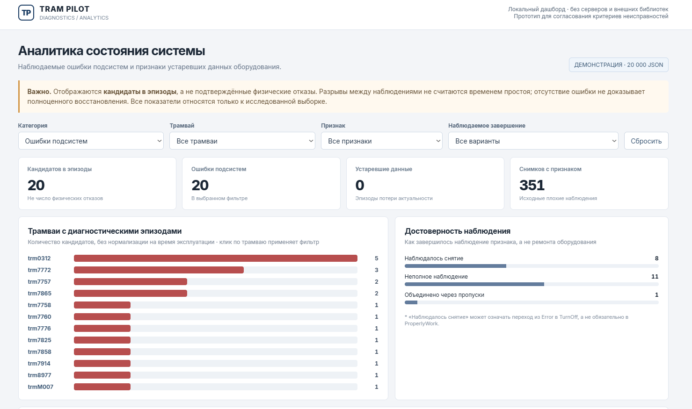

# Tram Pilot Analytics

## 1. Назначение

Разработал исследовательский конвейер для анализа диагностических состояний в телеметрии Tram Pilot. Результат — наблюдаемые сегменты и предполагаемые эпизоды ошибок, связанные с исходными JSON. В репозиторий включил код обработки и синтетические примеры. Визуализация пока существует отдельно как локальный прототип.

## 2. Технологии

Python 3.10+, стандартная библиотека: `tarfile`, `json`, `csv`, `gzip`, `sqlite3`, `unittest`. Для TAR.ZST нужен Python 3.14+ со встроенным Zstandard либо команда `zstd` в PATH. CSV.GZ не требует сторонних Python-библиотек. Временный SQLite-файл используется для сортировки и удаления дубликатов, затем удаляется.

## 3. Что реализовал

- Изучил структуру данных: отдельные JSON и контейнеры `events`.
- Реализовал потоковое чтение архива без полной распаковки.
- Нормализовал числа, флаги и время; отсутствующие значения сохранил как неизвестные.
- Разработал обработку диагностических состояний и добавил группировку наблюдений.
- Добавил синтетические примеры и тесты обработки.
- Сделал локальный прототип дашборда для просмотра результатов анализа.

## 4. Структура

```text
scripts/
  tram_pilot_probe.py      — профиль структуры JSON
  tram_pilot_ingest.py     — нормализация в CSV.GZ
  tram_pilot_incidents.py  — диагностические сегменты
  tram_pilot_episodes.py   — предполагаемые эпизоды и связи с сегментами
  _archive.py             — потоковое чтение TAR.ZST
  run_example.py          — сборка синтетического архива и полный прогон
  __init__.py
examples/
  direct_track.json       — вымышленная запись Track
  events_container.json   — вымышленные Track, Warn, Brake и OverSpeed
tests/test_pipeline.py
docs/images/dashboard_preview.png  — скриншот локального HTML-прототипа
requirements.txt
.gitignore
README.md
```

## 5. Дашборд (локальный прототип)

Сделал простой дашборд для просмотра результатов обработки: фильтрация по трамваю и типу диагностического признака, основные показатели, распределение эпизодов, временная шкала и таблица с деталями.



На скриншоте показан **отдельный HTML-прототип** на исследованной выборке. Он не входит в код публичного репозитория; это не скриншот Streamlit. Значения отражают предварительный анализ и не являются подтверждёнными отказами оборудования.

## 6. Установка

Установить Python 3.14; для Python 3.10–3.13 дополнительно установить `zstd`. Команды ниже выполняются из корня проекта с доступным в PATH интерпретатором `python`:

```sh
python --version
python -m pip install -r requirements.txt
```

В `requirements.txt` нет обязательных пакетов. Если `python` недоступен, использовать путь к своему интерпретатору или соответствующую команду `python3`/`py`.

## 7. Пример запуска

```sh
python -m unittest discover -s tests -v
python scripts/run_example.py --output output/example
```

Все записи в `examples/` синтетические: идентификаторы `DEMO-*` и координаты вымышлены. Полный прогон создаёт TAR.ZST, CSV.GZ, сегменты и эпизоды в `output/example/`. На примере получается 6 эпизодов Error и 3 эпизода неактуальных данных. Для повторного запуска выбрать новый `--output`, например `output/example-2`.

Отдельные этапы для локального архива:

```sh
python scripts/tram_pilot_probe.py local/source.tar.zst --limit 20000 --output output/profile
python scripts/tram_pilot_ingest.py local/source.tar.zst --max-files 20000 --format csv --output output/ingested
python scripts/tram_pilot_incidents.py --input output/ingested --output output/diagnostics --gap-seconds 30
python scripts/tram_pilot_episodes.py --input output/diagnostics --output output/episodes --bridge-seconds 90
```

Связь файлов: ingest создаёт `track/part-*.csv.gz` и `events/part-*.csv.gz`; incidents читает только Track и создаёт `subsystem_error_segments.csv`, `sensor_stale_segments.csv`; episodes читает эти два файла и создаёт `candidate_error_episodes.csv`, `candidate_sensor_episodes.csv`, `episode_segment_links.csv`. Каждый этап также сохраняет JSON-сводку; probe сохраняет профиль и ограниченные образцы JSON. Эти локальные результаты исключены из Git. Каталоги результатов выбирать новыми.

## 8. Методика

Удалил одинаковые снимки Track без учёта имени файла и позиции в массиве. Сгруппировал наблюдения по `(loco_number, device_id, cabin_type)` и отсортировал по времени. `Error` любой из трёх подсистем учитывается как общий признак; `false` у оборудования означает неактуальные данные.

Разрыв **более 30 секунд** разделяет сегменты. Соседние сегменты одной группы и признака объединяются через пропуски **до 90 секунд включительно**, если между ними не наблюдалось снятия признака. Интервалы без телеметрии и неизвестные границы сохранил отдельно от наблюдаемых состояний.

## 9. Ограничения

Эпизоды не подтверждают физический отказ, ремонт или непрерывный простой; MTTR/MTBF не рассчитываются. Отсутствующее поле не означает `false`. Непустой статус без Error не обязательно означает работоспособность. Смена неисправной подсистемы внутри общего Error отдельно не выделяется. Порядок противоречивых снимков с одинаковым временем может влиять на границы; ID эпизодов зависят от выборки. Глобальное удаление дублей событий не выполняется.

По умолчанию ingest ограничен 20 000 файлами, incidents — 250 000 строками; эти ограничения видны в сводках. Probe считает статусы прямых записей отдельно от вложенных событий. Для больших объёмов нужно проверить память, место для временной сортировки и чувствительность к порогам. Дополнительный экспорт Parquet сохранён из прототипа, требует `pyarrow` и не входит в проверенный CSV.GZ-сценарий.

Сохранил исправления очевидных дефектов с регрессионными тестами: потеря `multiImages`, усечение дробных чисел, пропуск дубликатов из-за позиции в массиве и объединение после наблюдаемого снятия признака. Пороги 30/90 секунд не изменял. Реальные JSON/CSV, внутренняя документация, код дашборда и локальные окружения в комплект не включены. Скриншот отображает результаты локального анализа; возможность его публичного размещения нужно согласовать с владельцем данных.
